# AlgoMind — Implementation-Based Backend, Database, and Data-Flow Analysis

**Prepared:** 2026-10-26  
**Purpose:** Evidence-based input for the Software Design Specification (SDS).  
**Status convention:** **Verified** = directly visible in source; **Partially verified** = some but not all of the flow is evidenced; **Not implemented** = no corresponding backend implementation was found; **Unverified** = requires a running deployment or database.

## 1. System overview

**Verified.** The repository contains a React/TypeScript/Vite frontend and a Node.js/Express/TypeScript backend. The backend uses Mongoose and Socket.IO. MongoDB is required for backend startup through `MONGODB_URI`; the repository does not establish whether the configured server is MongoDB Atlas or another MongoDB deployment. The frontend is configured to rewrite paths to its SPA entry point using Vercel-style `vercel.json`, but this does not verify a deployed frontend. No backend Render deployment manifest was found.

Backend startup is in [Backend/src/index.ts](Backend/src/index.ts): dotenv is loaded, required environment-variable *names* are checked, Express and Socket.IO are configured, handlers are registered, MongoDB is connected, and then the HTTP server listens. Database connection is in [Backend/src/config/db.ts](Backend/src/config/db.ts). Configuration values and credentials are deliberately not reproduced here.

The backend offers:

- Email-verification signup, password login, and JWT-protected current-user retrieval.
- Solo REST game endpoints for Dijkstra, BST, and Sorting.
- Solo completion activity/XP recording through an authenticated session endpoint.
- Socket.IO multiplayer for Dijkstra, BST, and Sorting, with different persistence behavior per game.
- MongoDB-backed schemas for users, daily activity, pending signups, game rounds, and Dijkstra multiplayer results.

The UI also lists Floyd–Warshall, Missing Operator, and Maths Questions. Their game boards are not backed by corresponding REST routes in this backend. The Floyd–Warshall board emits socket events and calls a REST path that this backend does not register; corresponding server handlers are absent. The leaderboard and dashboard display hard-coded sample data.

## 2. Backend architecture and database connection

The backend is organized as Express routes → controllers → Mongoose models/utilities, plus Socket.IO handlers and in-memory room managers. Route mounts are in [Backend/src/index.ts](Backend/src/index.ts). Authentication middleware is [Backend/src/middleware/auth.ts](Backend/src/middleware/auth.ts); the final Express error handler is [Backend/src/middleware/errorHandler.ts](Backend/src/middleware/errorHandler.ts).

`connectDB()` reads `MONGODB_URI` and calls `mongoose.connect()`. A missing URI throws; a connection failure is logged and terminates the process. The app requires `MONGODB_URI` and `JWT_SECRET`; production additionally requires `CLIENT_URL`. `BREVO_API_KEY`, `BREVO_SENDER_EMAIL`, and optional `BREVO_SENDER_NAME` are read by the email utility. The frontend uses `VITE_API_URL`, falling back to `http://localhost:5000`. No environment-file values were inspected or included.

**Unverified:** Source inspection cannot confirm the live database name, actual collections/indexes, data volume, Atlas use, deployed environment variables, or production host. Collection names below are the Mongoose default pluralized names inferred from model names, not confirmed by querying MongoDB.

## 3. Database inventory and data dictionary

### 3.1 Collection inventory

| Inferred collection | Model/schema | Status and purpose |
|---|---|---|
| `users` | `User` — [Backend/src/models/User.ts](Backend/src/models/User.ts) | **Verified active.** Signup/login/profile reads and XP/streak updates. |
| `useractivities` | `UserActivity` — [Backend/src/models/UserActivity.ts](Backend/src/models/UserActivity.ts) | **Verified active.** One daily activity/points record per user/day is upserted by the activity tracker. |
| `pendingsignups` | `PendingSignup` — [Backend/src/models/PendingSignup.ts](Backend/src/models/PendingSignup.ts) | **Verified active.** Temporary signup/OTP state; TTL cleanup is defined. |
| `matchresults` | `MatchResult` — [Backend/src/models/MatchResult.ts](Backend/src/models/MatchResult.ts) | **Verified active, limited to Dijkstra live matches.** Final per-player match snapshots for authenticated players. |
| `bstmatches` | `BstMatch` — [Backend/src/models/BstMatch.ts](Backend/src/models/BstMatch.ts) | **Partially used.** Solo question documents are created; update code exists, but the current frontend does not pass the returned `matchId` to the submit call, so its normal completion path does not update the record. No user association is set. |
| `dijkstramatches` | `DijkstraMatch` — [Backend/src/models/DijkstraMatch.ts](Backend/src/models/DijkstraMatch.ts) | **Verified active.** Solo graph and hidden shortest-path answer; TTL after one hour. |
| `sortingmatches` | `SortingMatch` — [Backend/src/models/SortingMatch.ts](Backend/src/models/SortingMatch.ts) | **Verified active.** Solo sorting round, step state, and answers; TTL after one hour. |

No model or operation was found for standalone auth sessions, refresh tokens, leaderboard rows, game-history queries, invitations, matchmaking queues, or multiplayer rooms. Those are either JWTs, embedded data, in-memory structures, frontend state, or absent features—not additional MongoDB collections.

Every top-level Mongoose document receives an `_id` ObjectId and the default numeric `__v` version key unless disabled. Neither is declared explicitly in these schemas. Mongoose array subdocuments whose schemas use `{ _id: false }` do not receive their own subdocument `_id`. Schema-declared `unique` fields and indexes request MongoDB indexes; their successful creation in a live database is **Unverified**.

### 3.2 Field-level data dictionary

CRUD notation: **C** create/insert, **R** read, **U** update, **D** delete. “TTL D” means MongoDB TTL cleanup is declared in the schema and is performed asynchronously by the database once its TTL index exists. Read operations generally retrieve the selected Mongoose document; the source does not project individual business fields unless a response shape is described.

| Collection | Field | Data type | Required? | Default / validation / index | Reference | Purpose | CRUD operations and source |
|---|---|---|---|---|---|---|---|
| `users` | `_id` | ObjectId | Yes (Mongoose) | Automatic primary identifier | — | User document identity | C/R/U via [User.ts](Backend/src/models/User.ts), [authController.ts](Backend/src/controllers/authController.ts), [activityTracker.ts](Backend/src/utils/activityTracker.ts) |
| `users` | `username` | String | Yes | `trim`; unique | — | Display/login name | C signup; R login/profile/socket lookup; [authController.ts](Backend/src/controllers/authController.ts), [socketHandlers.ts](Backend/src/sockets/socketHandlers.ts) |
| `users` | `usernameLower` | String | No | Unique, sparse; populated at account creation | — | Case-insensitive username key | C signup; R availability/login; [authController.ts](Backend/src/controllers/authController.ts) |
| `users` | `email` | String | Yes | `lowercase`, `trim`; unique | — | Account identifier | C signup; R duplicate check/login/profile; [authController.ts](Backend/src/controllers/authController.ts) |
| `users` | `passwordHash` | String | Yes | bcrypt hash; plaintext is not stored by application code | — | Credential verifier | C signup; R login comparison; [authController.ts](Backend/src/controllers/authController.ts) |
| `users` | `age` | Number | No | No explicit default or range validation | — | Optional profile attribute; not currently written/read by app flows | No application CRUD found |
| `users` | `current_streak` | Number | No | Default `0` | — | Current consecutive active-day count | C default; R `/me`; U activity tracker |
| `users` | `longest_streak` | Number | No | Default `0` | — | Maximum streak | C default; R `/me`; U activity tracker |
| `users` | `last_active_date` | Date or null | No | Default `null` | — | Last UTC activity day used by streak logic | C default; R/U activity tracker |
| `users` | `totalXP` | Number | No | Default `0` | — | Accumulated XP | C default; R login/signup `/me`; U activity tracker |
| `users` | `created_at` | Date | Mongoose timestamp | Generated by `{ timestamps: { createdAt: "created_at", updatedAt: "updated_at" } }` | — | Account creation time | C automatically; read only as part of documents; [User.ts](Backend/src/models/User.ts) |
| `users` | `updated_at` | Date | Mongoose timestamp | Automatically maintained by Mongoose timestamps | — | Last document update | C/U automatically; [User.ts](Backend/src/models/User.ts) |
| `users` | `__v` | Number | Mongoose default | Default version key | — | Mongoose version metadata | Automatic |
| `useractivities` | `_id` | ObjectId | Yes (Mongoose) | Automatic primary identifier | — | Activity document identity | C/U through upsert; [activityTracker.ts](Backend/src/utils/activityTracker.ts) |
| `useractivities` | `user_id` | ObjectId | Yes | `ref: "User"`; part of unique compound index `{ user_id: 1, activity_date: 1 }` | `users._id` (Mongoose ref; not DB-enforced FK) | Owner of daily activity | C/U upsert selector; [activityTracker.ts](Backend/src/utils/activityTracker.ts) |
| `useractivities` | `activity_date` | Date | Yes | UTC date normalized to midnight; same compound unique index | — | Activity day | C/U upsert selector; [activityTracker.ts](Backend/src/utils/activityTracker.ts) |
| `useractivities` | `submission_count` | Number | No | Default `0`; `$inc` | — | Count of tracked completions/submissions | C default/U increment; [activityTracker.ts](Backend/src/utils/activityTracker.ts) |
| `useractivities` | `points_earned` | Number | No | Default `0`; `$inc` | — | XP recorded for activity day | C default/U increment; [activityTracker.ts](Backend/src/utils/activityTracker.ts) |
| `useractivities` | `__v` | Number | Mongoose default | Default version key | — | Mongoose version metadata | Automatic |
| `pendingsignups` | `_id` | ObjectId | Yes (Mongoose) | Automatic primary identifier | — | Pending signup identity | C/R/U/D in signup controller |
| `pendingsignups` | `email` | String | Yes | `lowercase`, `trim`, unique | — | Signup key | C/upsert, R, D by email; [authController.ts](Backend/src/controllers/authController.ts) |
| `pendingsignups` | `passwordHash` | String | Yes | bcrypt hash | — | Deferred account credential | C/upsert, R during completion |
| `pendingsignups` | `otpHash` | String | Yes | HMAC-SHA256 using `JWT_SECRET` | — | Verification-code verifier | C/U/R during verify/resend |
| `pendingsignups` | `attempts` | Number | No | Default `0`; atomically incremented; max attempts constant is 5 | — | Failed OTP attempt count | C default/U increment/reset/R; auth controller |
| `pendingsignups` | `lastSentAt` | Date | No | Default `Date.now`; resend cooldown check | — | OTP resend timing | C default/U/R; auth controller |
| `pendingsignups` | `verified` | Boolean | No | Default `false` | — | OTP verification status | C default/U/R; auth controller |
| `pendingsignups` | `signupTokenHash` | String | No | No explicit default; hash of random token | — | Proof required to complete signup | U/R, then pending document deleted on success |
| `pendingsignups` | `expiresAt` | Date | Yes | TTL index `expireAfterSeconds: 0` | — | OTP/signup expiry timestamp | C/U/R; TTL D; auth controller and schema |
| `pendingsignups` | `__v` | Number | Mongoose default | Default version key | — | Mongoose version metadata | Automatic |
| `matchresults` | `_id` | ObjectId | Yes (Mongoose) | Automatic primary identifier | — | Result document identity | C in Dijkstra `endMatch`; no application read/update/delete found |
| `matchresults` | `gameType` | String | Yes | No enum; current creator writes room game type | — | Game classification | C in [socketHandlers.ts](Backend/src/sockets/socketHandlers.ts) |
| `matchresults` | `roomId` | String | Yes | No uniqueness constraint | — | Match identifier snapshot | C in Dijkstra `endMatch` |
| `matchresults` | `players` | Array of embedded player objects | Yes | Nested schema required; no minimum length specified | Contains `players[].user_id` ref | Match participant results | C in Dijkstra `endMatch`; no application read/update/delete found |
| `matchresults` | `players[].user_id` | ObjectId | Yes | `ref: "User"`; multikey index `{ "players.user_id": 1 }` | `users._id` (Mongoose ref; no DB FK) | Authenticated participant | C in Dijkstra `endMatch` |
| `matchresults` | `players[].username` | String | Yes | No explicit validation beyond required | — | Username snapshot | C in Dijkstra `endMatch` |
| `matchresults` | `players[].correctCount` | Number | Yes | No range validation | — | Stored completed-round count in current writer | C in Dijkstra `endMatch` |
| `matchresults` | `players[].totalRounds` | Number | Yes | Current writer sets this equal to `correctCount` | — | Stored round count | C in Dijkstra `endMatch` |
| `matchresults` | `players[].accuracy` | Number | Yes | Current calculation rounds to integer percent | — | Correct actions / attempts percentage | C in Dijkstra `endMatch` |
| `matchresults` | `players[].xpEarned` | Number | Yes | Current writer uses `correctCount * 10` | — | XP grant snapshot | C in Dijkstra `endMatch` |
| `matchresults` | `players[].result` | String | Yes | Enum `"win"`, `"loss"`, `"tie"` | — | Per-player match outcome | C in Dijkstra `endMatch` |
| `matchresults` | `startedAt` | Date | Yes | Current writer estimates from end time minus 60 seconds | — | Start time snapshot | C in Dijkstra `endMatch` |
| `matchresults` | `endedAt` | Date | No | Default `Date.now`; writer supplies current time | — | End time | C in Dijkstra `endMatch` |
| `matchresults` | `__v` | Number | Mongoose default | Default version key | — | Mongoose version metadata | Automatic |
| `bstmatches` | `_id` | ObjectId | Yes (Mongoose) | Automatic primary identifier | — | Match document identity | C/U; [bstController.ts](Backend/src/controllers/bstController.ts) |
| `bstmatches` | `matchId` | String | Yes | Unique | — | Client-visible solo question identifier | C in `getQuestion`; U selector in `submitScore` |
| `bstmatches` | `userId` | String | No | No reference or explicit validation; never populated by current question creator | None; not a Mongoose ref | Intended but currently unused user association | No application write found |
| `bstmatches` | `numbers` | Number array | Yes | No length/range validation in schema | — | Generated insertion sequence | C in `getQuestion`; returned to frontend |
| `bstmatches` | `score` | Number | No | Default `0` | — | Submitted score | C default; U in `submitScore` when a match ID is provided |
| `bstmatches` | `completed` | Boolean | No | Default `false` | — | Completion marker | C default; U in `submitScore` |
| `bstmatches` | `createdAt` | Date | No | Default `Date.now`; no TTL | — | Question creation time | C default; no application read/delete found |
| `bstmatches` | `__v` | Number | Mongoose default | Default version key | — | Mongoose version metadata | Automatic |
| `dijkstramatches` | `_id` | ObjectId | Yes (Mongoose) | Automatic primary identifier | — | Match document identity | C/R; TTL D |
| `dijkstramatches` | `graphId` | String | Yes | Unique | — | Solo graph identifier | C in `createDijkstraMatch`; R in `validateDijkstraStep` |
| `dijkstramatches` | `nodes` | Array of embedded nodes | Yes | Nested schema; node subdocuments `_id: false` | — | Graph node data | C/R in Dijkstra controller |
| `dijkstramatches` | `nodes[].id` | String | Yes | Required | — | Node key | C/R in Dijkstra controller |
| `dijkstramatches` | `nodes[].label` | String | Yes | Required | — | Display label | C/R in Dijkstra controller |
| `dijkstramatches` | `edges` | Array of embedded edges | Yes | Nested schema; edge subdocuments `_id: false` | — | Graph connectivity and weights | C/R in Dijkstra controller |
| `dijkstramatches` | `edges[].source` | String | Yes | Required | — | Edge endpoint | C/R in Dijkstra controller |
| `dijkstramatches` | `edges[].target` | String | Yes | Required | — | Edge endpoint | C/R in Dijkstra controller |
| `dijkstramatches` | `edges[].weight` | Number | Yes | Required | — | Edge weight | C/R in Dijkstra controller |
| `dijkstramatches` | `start` | String | Yes | Required | — | Start node ID | C/R in Dijkstra controller |
| `dijkstramatches` | `target` | String | Yes | Required | — | Target node ID | C/R in Dijkstra controller |
| `dijkstramatches` | `shortestPath` | String array | Yes | Required; withheld from solo API response | — | Server-side correct path | C in controller; R for validation |
| `dijkstramatches` | `createdAt` | Date | No | Default `Date.now`; TTL `expires: 3600` | — | Creation/TTL base | C default; TTL D after about one hour |
| `dijkstramatches` | `__v` | Number | Mongoose default | Default version key | — | Mongoose version metadata | Automatic |
| `sortingmatches` | `_id` | ObjectId | Yes (Mongoose) | Automatic primary identifier | — | Round document identity | C/R/U; TTL D |
| `sortingmatches` | `roundId` | String | Yes | Unique | — | Solo sorting-round identifier | C in `createSortingRound`; R in `validateSortingStep` |
| `sortingmatches` | `algo` | String | Yes | Enum: bubble, insertion, selection, merge, quick, heap | — | Algorithm for round | C/R in sorting controller |
| `sortingmatches` | `steps` | Array of embedded steps | Yes | Step schema; subdocument `_id: false` | — | Round state, prompts, expected answers | C/R/U through `stepIndex` in sorting controller |
| `sortingmatches` | `steps[].kind` | String | Yes | Enum: `swap-or-keep`, `pick-min`, `pick-choice` | — | UI/input mode | C/R |
| `sortingmatches` | `steps[].arr` | Array of embedded sort items | Yes | Item `_id: false` | — | Array snapshot for step | C/R |
| `sortingmatches` | `steps[].arr[].id` | Number | Yes | Required | — | Item identity/order | C/R |
| `sortingmatches` | `steps[].arr[].value` | Number | Yes | Required | — | Sort value | C/R |
| `sortingmatches` | `steps[].focus` | Number array | Yes | Required; indexes | — | Focused item indexes | C/R |
| `sortingmatches` | `steps[].sorted` | Number array | Yes | Required; indexes | — | Sorted item indexes | C/R |
| `sortingmatches` | `steps[].range` | Number array | No | No tuple-length schema constraint | — | Applicable comparison range | C/R |
| `sortingmatches` | `steps[].prompt` | String | No | No default | — | Optional prompt text | C/R |
| `sortingmatches` | `steps[].choices` | Embedded choice array | No | Choice subdocuments `_id: false` | — | Optional answer choices | C/R |
| `sortingmatches` | `steps[].choices[].value` | String | Yes when choice exists | Required | — | Submitted answer token | C/R |
| `sortingmatches` | `steps[].choices[].label` | String | Yes when choice exists | Required | — | Choice display label | C/R |
| `sortingmatches` | `steps[].answer` | Mixed | Yes | `Schema.Types.Mixed`; generated boolean, number, or string; type-checked in controller | — | Authoritative correct step answer | C in round generation; R for validation; not sent by public step serializer |
| `sortingmatches` | `finalArr` | Embedded sort-item array | Yes | Item subdocuments `_id: false` | — | Completed sorted array | C/R; conditionally returned on completion |
| `sortingmatches` | `finalArr[].id` | Number | Yes | Required | — | Item identity | C/R |
| `sortingmatches` | `finalArr[].value` | Number | Yes | Required | — | Sorted value | C/R |
| `sortingmatches` | `stepIndex` | Number | No | Default `0` | — | Current step position | C default; U on correct answer |
| `sortingmatches` | `attempts` | Number | No | Default `0` | — | Total submitted attempts | C default; U each valid-form submission |
| `sortingmatches` | `mistakes` | Number | No | Default `0` | — | Incorrect answers | C default; U on incorrect answer |
| `sortingmatches` | `completed` | Boolean | No | Default `false` | — | Round completion state | C default; U when final step correct |
| `sortingmatches` | `createdAt` | Date | No | Default `Date.now`; TTL `expires: 3600` | — | Creation/TTL base | C default; TTL D after about one hour |
| `sortingmatches` | `__v` | Number | Mongoose default | Default version key | — | Mongoose version metadata | Automatic |

## 4. Logical entities and relationships

### 4.1 Entity inventory

| Entity | Representation and attributes | Relationships / lifecycle / use |
|---|---|---|
| User | MongoDB `users` document: identity, password hash, optional age, XP, streak fields, timestamps | Created after verified signup; read for login/profile and socket username; updated for activity/XP. No application delete or profile-update route found. |
| Pending signup | MongoDB `pendingsignups` document: email, credential/OTP hashes, attempts, verification state, signup-token hash, expiry | One pending signup per unique email; no User relation field. Deleted after successful account creation or email-send failure; TTL expiry is declared. |
| JWT authentication token | Stateless signed string containing `userId`, expires in 7 days | Not a collection and no revocation record. Stored by frontend in browser `localStorage`; API and socket auth consume it. |
| User daily activity | MongoDB `useractivities` document keyed by `user_id` + UTC `activity_date`; submission count and points | Mongoose `User` ref; compound unique index; upserted by activity tracker. |
| Dijkstra solo match | MongoDB `dijkstramatches` document with graph, answer path, graph ID, created time | No user reference; temporary server-side validation state, TTL about one hour. |
| Sorting solo round | MongoDB `sortingmatches` document with steps, answers, score-like counters, completion state | No user reference; temporary server-side validation state, TTL about one hour. |
| BST solo match | MongoDB `bstmatches` document with question numbers, match ID, score/completed and optional string `userId` | No enforced relation and creator does not set `userId`. The frontend retains the returned ID but currently calls submit without it. No TTL is declared. |
| Multiplayer match result | MongoDB `matchresults` document containing game type, room ID, timestamps, and embedded per-player result snapshots | Current writer is Dijkstra live `endMatch`; only logged-in participants are included. Embedded `players[].user_id` is a Mongoose ref to User; no read/history API found. |
| Multiplayer room/player/queue | In-memory objects and Maps/arrays in `roomManager.ts` and `sortingRoomManager.ts`; socket IDs, scores, attempts, current game state, codes | Exists only during process lifetime; no MongoDB or Redis persistence. Guest participants have no user ID. |
| Game graph/question and answer | Generated server-side, then stored in Dijkstra/Sorting/BST solo collections or in live-room memory | No standalone question collection. |
| Leaderboard/history | Frontend mock data only for leaderboard; no history page/API found | Not an implemented persistent entity. |
| Guest player | Socket handshake attributes and ephemeral room `Player` state | Not a User; guest identity is sanitized for BST room-code play. No persistence. |
| Floyd–Warshall, Maths Questions, Missing Operator game state | Frontend React component state and browser runtime | No corresponding backend persistence/REST handlers found. Floyd–Warshall emits client socket messages without matching server handlers. |

### 4.2 Relationships and ER diagram

**Verified relationships:** `UserActivity.user_id` and embedded `MatchResult.players[].user_id` declare Mongoose `ref: "User"`. These are application-level references; MongoDB does not enforce referential integrity and the code does not call `populate()`. There is no explicit match-to-user reference in Dijkstra or Sorting solo documents. `BstMatch.userId` is a plain optional string and is not assigned by the current creator.

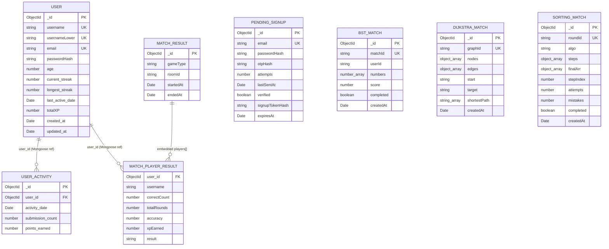

The `FK` labels above mean “schema-level Mongoose reference,” not database-enforced foreign keys. Embedded result players are not an independent collection. No relationship is drawn for name similarity or for in-memory rooms.

## 5. Persistent storage versus temporary state

| Data/object | Storage location | Persisted in MongoDB? | Lost on server restart? | Use |
|---|---|---:|---:|---|
| Accounts and XP/streak counters | `User` documents | Yes | No, subject to database availability | Authentication/profile/progress |
| Daily activity | `UserActivity` documents | Yes | No | Activity and earned points |
| OTP signup state | `PendingSignup` documents | Yes, until deletion/TTL | No (until TTL or explicit deletion) | Signup verification |
| Solo Dijkstra graph and answer | `DijkstraMatch` documents | Yes, TTL declared | Survives process restart until TTL | Server-side answer validation |
| Solo Sorting steps and answers | `SortingMatch` documents | Yes, TTL declared | Survives process restart until TTL | Server-side answer validation |
| Solo BST question/score | `BstMatch` documents | Question creation is persisted | Survives restart; no TTL | BST question record; completion update currently not reached by normal frontend submit path |
| Dijkstra live results | `MatchResult` documents | Yes, for authenticated participants | No | Match snapshots and XP/progress source |
| Live room/player state and queues | Module-level Maps/arrays and Socket.IO room membership | No | Yes | Invite rooms, queues, game state and transient scores |
| Live BST tree, sequence, timers | `Room.bstState` in memory | No | Yes | BST multiplayer |
| Live sorting rounds/player progress | `SortingRoom` Maps and arrays | No | Yes | Sorting multiplayer |
| JWT | Browser `localStorage` (`algomind_token`) and client socket handshake | No | Browser token persists until cleared/expired; server has no token record | Client authentication |
| Results-screen/session stats | React state and router navigation state | No | Yes; direct navigation/reload can lose it | Display-only result snapshot |
| Solo game board state, temporary scores, timers | React component state; D3 visualization state | No | Yes | Gameplay UI |
| Guest name/identity | Socket handshake and room player object | No | Yes | Guest BST room-code multiplayer |
| Redis/other external cache | No use or dependency found | No | N/A | None |

Multiplayer persistence differs by implementation. Dijkstra writes a `MatchResult` and updates activity/XP for authenticated players at match end. BST live emits results and removes the room without a database write. Sorting live emits results and removes the room without a database write. Guest participants are excluded from the Dijkstra result document. Active rooms, scores, queues and unfinished live matches are lost on process restart.

## 6. REST API inventory

All paths are mounted under `/api`. Authentication means a `Bearer` JWT checked by `authMiddleware`, except where stated otherwise.

| Group | Method and path | Auth | Request and response | Handler/model/data effect |
|---|---|---|---|---|
| System | `GET /api/health` | No | `{}` → `{ status: "ok" }` | Inline in [index.ts](Backend/src/index.ts); no database check. |
| System | `GET /api/debug/ip` | No; route exists only when `DEBUG_IP=1` | Returns request IP and forwarded-for header | Inline debug route; no DB effect. |
| Auth | `POST /api/auth/signup/start` | No | `{ email, password }` → `{ ok, resendAfterSeconds }`; validation/conflict/rate-limit errors | `signupStart`; reads User/PendingSignup, upserts pending hash/OTP state, sends email; deletes pending record if email delivery fails. |
| Auth | `POST /api/auth/signup/verify` | No | `{ email, code }` → `{ ok, signupToken }` | `signupVerify`; atomic PendingSignup attempt increment/read, checks OTP, updates verified/token hash/expiry. |
| Auth | `POST /api/auth/signup/resend` | No | `{ email }` → `{ ok, resendAfterSeconds }` | `signupResend`; reads/updates pending record and sends email. |
| Auth | `POST /api/auth/signup/complete` | No | `{ email, signupToken, username }` → `{ token, user }` | `signupComplete`; reads pending signup, creates User, deletes pending record; unique conflicts return 409. |
| Auth | `GET /api/auth/username-available?u=...` | No | Query `u` → `{ available }` or `{ available:false, reason }` | `usernameAvailable`; User existence read. |
| Auth | `POST /api/auth/login` | No | `{ identifier, password }` (or `email`) → `{ token, user }` | `login`; User read and bcrypt compare; signed JWT lasts 7 days. |
| Auth | `GET /api/auth/me` | Yes | Bearer token → `{ id, username, email, totalXP, current_streak, longest_streak }` | `getMe`; User read by ID; 404 if absent. |
| Progress | `POST /api/sessions/solo` | Yes | `{ correctCount }` (non-negative number) → `{ xpEarned }` | `completeSoloSession`; computes `correctCount * 10`, then `recordActivityAndXP`; updates UserActivity and User. Does not validate a game/session ID or verify results. |
| Dijkstra solo | `GET /api/games/dijkstra/new?round=...` | Yes | Round query → `{ graphId, nodes, edges, start, target }`; omits hidden shortest path | `createDijkstraMatch`; creates DijkstraMatch. |
| Dijkstra solo | `POST /api/games/dijkstra/validate-step` | Yes | `{ graphId, currentNode, chosenNode }` → `{ correct, isComplete }` | `validateDijkstraStep`; reads DijkstraMatch and validates graph node/path. |
| BST solo | `GET /api/games/bst/question?count=...` | No | Count query → `{ success:true, data:{ matchId, numbers } }` | `getQuestion`; creates BstMatch. Count is not bounded against the 17-value generator pool. |
| BST solo | `POST /api/games/bst/validate` | No | `{ parentValue, side, value }` → `{ success:true, valid }` | `validatePlacement`; only compares provided values and side; does not read BST state or use matchId. |
| BST solo | `POST /api/games/bst/submit` | No | `{ matchId, score, placed }` → success and `{ score, placedCount }` | `submitScore`; updates `score` and `completed` by matchId if matchId is truthy; does not check whether a document was matched. |
| Sorting solo | `GET /api/games/sorting/new?round=...` | No | Positive safe integer round → round ID, algo, first public step, counts, completion flag | `createSortingRound`; creates SortingMatch; answer is omitted from public step. |
| Sorting solo | `POST /api/games/sorting/validate-step` | No | `{ roundId, answer }` → correctness, state/next public step and final array when complete | `validateSortingStep`; reads and saves SortingMatch step index, attempts, mistakes, completed. |

There are **no implemented backend endpoints** for profile updates, leaderboard retrieval, game-history retrieval, Floyd–Warshall answers, Maths Questions answers, Missing Operator answers, invitations as persistent objects, or generic saved solo match results.

## 7. Socket.IO inventory

Socket handlers are registered from [Backend/src/index.ts](Backend/src/index.ts). Handshake authentication is in `resolveSocketAuth` / middleware in [Backend/src/sockets/socketHandlers.ts](Backend/src/sockets/socketHandlers.ts). A valid JWT provides user identity; guest handshake is accepted by the shared middleware, but the generic room handler allows guest room-code play only for BST. The client creates the handshake using its saved token or guest flag in [Frontend/src/lib/socket.ts](Frontend/src/lib/socket.ts).

**Authorization distinction:** the dedicated Sorting socket handlers do not check `socket.data.isGuest`; therefore the server-side restriction to guest BST applies to the generic Dijkstra/BST handler, not uniformly to all game socket handlers. The current frontend route guards Sorting multiplayer for guests, but route guards are client-side and do not enforce this server-side policy.

### 7.1 Shared lobby and Dijkstra/BST events

| Event | Direction | Payload / behavior | Persistence and error/lifecycle |
|---|---|---|---|
| `join_queue` | Client → server | `{ gameType }`; adds authenticated player to per-game queue | In-memory only. Guest is rejected here. `sorting` is handled by its dedicated handler. |
| `queue_joined` | Server → client | No significant payload | Acknowledges waiting. |
| `cancel_queue` | Client → server | `{ gameType }` | Removes from in-memory generic queue. Sorting uses `leave_queue`. |
| `matched` | Server → client | `{ roomId, gameType?, code? }` | Room created in memory; no DB write. |
| `create_room` | Client → server | `{ gameType, userId? }`; identity checked against socket auth | Guest restricted to BST; code/room stored in memory. |
| `room_created` | Server → client | `{ roomId, code, gameType? }` | No persistence. |
| `join_room` | Client → server | `{ code, gameType, userId? }` | Validates code and room/game eligibility, then puts sockets in room. |
| `room_joined` | Server → client | `{ roomId, gameType, code? }` | No persistence. |
| `join_room_error`, `live_unavailable` | Server → client | `{ message }` | Error messages for join/auth/game eligibility. |
| `opponent_joined` | Server → client | Room ID/game type/code | Host notification. |
| `cancel_room` | Client → server | Optional room ID for Sorting; generic Dijkstra/BST uses socket association | Waiting room removed from memory. |
| `opponent_left` | Server → client | Optional `{ gameType, graceMs }` | Disconnect/leave notification; Dijkstra/BST may wait 15 seconds before ending. |

### 7.2 Dijkstra live gameplay

| Event | Direction | Payload / behavior | Persistence |
|---|---|---|---|
| `match_start`, `round_data`, `round_state` | Server → client | Round number, graph nodes/edges/start/target (no shortest path) | Current round state in memory. |
| `request_round_state` | Client → server | No payload | Re-sends current round to requesting room member. |
| `submit_step` | Client → server | `{ currentNode, chosenNode }` | Validates against in-memory shortest path; increments transient attempts/actions/score. |
| `step_result` | Server → client | `{ correct, isComplete }` | No direct DB write. |
| `opponent_progress` | Server → client | `{ score, correctCount }` | In-memory progress notification. |
| `match_end` | Server → client | Results array and `winnerSocketId` | Then Dijkstra stores MatchResult and activity/XP for authenticated players. DB errors are logged; no client acknowledgement of persistence. |

### 7.3 BST live gameplay

| Event | Direction | Payload / behavior | Persistence |
|---|---|---|---|
| `bst_match_start` | Server → client | `{ roomId, gameType, sequence, startedAt, endsAt, timeoutMs }` | Generated sequence/clock in memory; 120-second server timer. |
| `bst_progress` | Server → client | Per-player socket ID, username, correct count, attempts, index, finished, accuracy | In-memory only. |
| `bst_submit_move` | Client → server | `{ value, parentValue?, side?, roomId? }` | Server validates expected sequence and BST insertion; mutates in-memory tree/state. |
| `bst_move_result` | Server → client | Validity/reason, expected value, attempt/index/progress fields | In-memory only. |
| `bst_match_end` | Server → client | `{ roomId, gameType, reason, winnerSocketId, results }` | Room removed; no database write or activity/XP update. |

### 7.4 Sorting live gameplay

| Event | Direction | Payload / behavior | Persistence |
|---|---|---|---|
| `create_room`, `join_room`, `join_queue` | Client → server | Sorting uses `{ gameType:"sorting" }`, with code for joining | Dedicated Sorting handler; in-memory room/queue. |
| `queue_joined`, `room_created`, `room_joined`, `matched`, `opponent_joined` | Server → client | Waiting/match identifiers and room code where applicable | In-memory only. |
| `join_match`, `request_sorting_state` | Client → server | `{ roomId }` for join; no payload for request | Rejoins/gets transient current round state. |
| `sorting_room_joined`, `sorting_round_state` | Server → client | Status or player-specific public state | In-memory only. |
| `sorting_match_start`, `sorting_round_data` | Server → client | Round number, algorithm, total steps, duration for start | In-memory round; 420-second timer. |
| `submit_sorting_step` | Client → server | `{ answer }` | Correctness, step, score, attempts updated in memory. |
| `sorting_step_result`, `opponent_progress` | Server → client | Public step result or score/round progress | In-memory only. |
| `sorting_match_end` | Server → client | Player results and winner socket ID | Room removed; no database result/progress write. |
| `leave_queue`, `leave_match`, `cancel_room` | Client → server | Queue/room identifiers as relevant | Removes in-memory queue/room state; opponent notified. |
| `sorting_room_error` | Server → client | `{ message }` | Invalid room code/room lifecycle errors. |

Malformed gameplay socket payloads are often ignored without a structured error event. Socket.IO room membership is transient transport state, not a database entity. No Redis adapter, external queue, or distributed room store is configured.

## 8. Major data-flow traces

### 8.1 Registration and login

1. [Frontend/src/pages/SignupPage.tsx](Frontend/src/pages/SignupPage.tsx) calls signup start with email/password using `apiPost`.
2. `POST /api/auth/signup/start` normalizes/validates email, validates password, checks User uniqueness, hashes password and OTP, upserts PendingSignup, and sends through [Backend/src/utils/mailer.ts](Backend/src/utils/mailer.ts). Dev mode may log the code if no provider is configured; production requires mail settings.
3. OTP verification atomically increments attempts using PendingSignup `findOneAndUpdate`; successful verification marks `verified`, stores a hash of a random signup token, and extends expiry.
4. Username availability reads User by `usernameLower`; final signup re-verifies the token, creates User (username/email/password hash), deletes PendingSignup, signs a seven-day JWT, and returns public user fields.
5. Login from [Frontend/src/pages/LoginPage.tsx](Frontend/src/pages/LoginPage.tsx) → `AuthContext.login` → `POST /api/auth/login`; server queries by normalized email or username key and runs bcrypt compare. It returns token and public user fields.
6. The frontend stores JWT in browser `localStorage`. On reload, AuthContext calls `GET /api/auth/me`; REST middleware verifies the signature and expiry, and the controller reads User.

### 8.2 Solo game start, validation, and completion

**Dijkstra:** [Frontend/src/components/game-boards/DijkstraBoard.tsx](Frontend/src/components/game-boards/DijkstraBoard.tsx) requests an authenticated graph for each round. The controller generates nodes/edges, calculates the shortest path, stores all in DijkstraMatch, and returns only the public graph. Each click calls `POST /validate-step`; controller reads the match and validates the next path node. That endpoint does not persist per-move state. The frontend session shell and board keep score/counters in React. At timeout, `ResultsScreen` sends only `correctCount` to `POST /api/sessions/solo` when a token exists. That separate endpoint trusts the supplied count, computes XP as count × 10 and updates daily activity/User. The graph document expires by TTL; there is no durable solo Dijkstra match record.

**Sorting:** [Frontend/src/components/game-boards/SortingBoard.tsx](Frontend/src/components/game-boards/SortingBoard.tsx) requests a solo round and submits each answer. Backend stores round state, returns a step with answer removed, reads and saves attempts/mistakes/step index/completed on each submission, and returns next public step. On shell timeout, the frontend posts aggregate correct count to the solo-session endpoint; no sorting session record or user reference is created.

**BST:** [Frontend/src/components/game-boards/BSTBoard.tsx](Frontend/src/components/game-boards/BSTBoard.tsx) requests a generated number sequence, creating BstMatch and receiving `matchId`. Placement validation is primarily client-side; the REST validator only compares value and side, does not load match/tree state, and ignores matchId. The board stores the returned ID in component state but calls `submitScoreAPI(newScore, round)` without passing it. The controller updates only when `matchId` is truthy, so the current normal completion flow does not mark the generated document complete or save score. It still sends round correct count to the general solo completion endpoint via ResultsScreen if authenticated.

**Other listed games:** Floyd–Warshall, Maths Questions, and Missing Operator are frontend-driven and do not have matching REST API implementations. Floyd–Warshall’s `fetch` target and socket events have no corresponding backend route/event handler in the inspected source.

### 8.3 Activity, streaks, XP, history, leaderboard

`recordActivityAndXP` in [Backend/src/utils/activityTracker.ts](Backend/src/utils/activityTracker.ts) normalizes current UTC time to midnight, upserts `UserActivity` by `(user_id, activity_date)` with `$inc`, reads User, calculates a streak using the previous activity date, increments totalXP, and saves User. It is called by authenticated solo completion and by Dijkstra live match end. It does not run for solo guests, BST live, or Sorting live.

No history or leaderboard query route/model operation was found. [Frontend/src/pages/Leaderboard.tsx](Frontend/src/pages/Leaderboard.tsx) and [Frontend/src/pages/Dashboard.tsx](Frontend/src/pages/Dashboard.tsx) render constants/mock data; their comments identify future API work. There is no persisted daily-activity read endpoint.

### 8.4 Multiplayer lifecycle and persistence

Invite and queue pages emit Socket.IO lobby events. `roomManager.ts` stores generic rooms, code mappings, socket mappings, and per-game queues in module-level Maps. Sorting has a separate room manager and queue array. The server validates actions and broadcasts results from those in-memory objects.

- Dijkstra: 60-second match; completion/timeout produces `match_end`, removes room, stores a MatchResult for logged-in players, then records XP/activity. A persistence failure is logged; the match event has already been sent and the room removed.
- BST: two-player room-code mode supports guests; sequence/tree/attempts are in memory; first finisher, timeout, or disconnect finalizes and emits results, then removes room. No database result/activity/XP write.
- Sorting: 420-second match; scoring and accuracy are in memory; emits results and removes room. No database result/activity/XP write.
- Dijkstra/BST disconnects use a 15-second grace period in relevant branches; Sorting removes the room on disconnect and notifies the opponent. Server restart destroys all room/queue/player state.

### 8.5 Error and failure behavior

REST controllers mostly pass errors to centralized Express middleware or return explicit status/message JSON. The health endpoint only confirms the process responds; it does not test database readiness. Startup waits for MongoDB before listening. Signup mail delivery failure deletes the pending signup on start; resend failure resets its cooldown timestamp. The BST client catches validation network errors and returns `true`, allowing client-side validation to be used as a fallback. ResultsScreen intentionally ignores failed save calls so display remains available.

No transactional boundary spans signup account creation plus pending-record deletion, Dijkstra MatchResult creation plus activity updates, or daily activity plus User update. `recordActivityAndXP` writes activity before checking User existence; a valid token referring to a deleted User can therefore leave activity without a matching user. Concurrent activity upserts can collide on the unique daily index; there is no retry in the utility. Concurrent Sorting submissions read and save a shared `stepIndex` without an atomic compare-and-swap. Duplicate game-completion requests are not idempotency-keyed.

## 9. Business rules, validation, and integrity

| Rule | Enforcement layer and evidence |
|---|---|
| Email normalized lowercase; syntax/length and a built-in disposable-domain denylist | Backend validators; User/PendingSignup schema also lowercase/trim and unique email. |
| Password minimum 8 characters and maximum 72 UTF-8 bytes | Backend validator; stored with bcrypt. |
| Username 7–20 characters, restricted character set, letter required, no punctuation at ends, reserved-name checks | Backend validator; unique `username` and sparse unique `usernameLower` indexes provide race-safe uniqueness when indexes exist. |
| OTP is 6 digits; ten-minute expiry, five attempts, one-minute resend cooldown | Backend controller/utilities; attempt count increment is atomic. Pending signup TTL index is declared. |
| JWT expires after seven days | JWT signing and verification; no logout/revocation store. |
| Solo session XP | Backend accepts any non-negative numeric `correctCount`, computes `count * 10`; it does not verify answers or game IDs. No upper bound or integer requirement is present. |
| Daily streak | Backend uses UTC-midnight dates; consecutive previous UTC day increments, otherwise starts at 1; same-day activity does not increment again. |
| Dijkstra step | Backend checks node IDs and requires the next node on the stored shortest path. Match does not bind to a user, and endpoint uses graph ID as selector. |
| BST solo placement | REST endpoint checks only `value < parentValue` or `value > parentValue`; actual tree invariants are client-validated. Match ID/tree is not checked by server. |
| BST question count | `parseInt(...) || 7`; no cap. Generator has only 17 distinct values and loops until `set.size === count`, so count above 17 can fail to terminate. |
| Sorting answer | Backend checks primitive type equality and strict equality against stored answer; answers are omitted by public step formatter. The round is not bound to a user. |
| Live Dijkstra winner | Higher completed count wins; ties broken by accuracy; equal stats yield tie. XP is completed count × 10. |
| Live BST winner | First finisher wins; timeout/disconnect fallback compares completion/count/accuracy. Guest names are sanitized. |
| Live Sorting winner | Higher score, then higher accuracy; equal values tie. Results are ephemeral. |
| Database reference integrity | Mongoose refs and indexes only; no MongoDB foreign-key enforcement, population, or cascade delete. No user delete behavior is implemented. |

Rate limiters are defined in [Backend/src/middleware/rateLimiters.ts](Backend/src/middleware/rateLimiters.ts). They use the package’s default in-process store; no distributed rate-limit store is configured. Schema and route validation differ: e.g., BST request values and the solo session `correctCount` lack stronger range/session binding checks. Rate limiting and validation behavior is source evidence only; deployment settings are unverified.

## 10. Activity diagrams

### 10.1 Signup and login

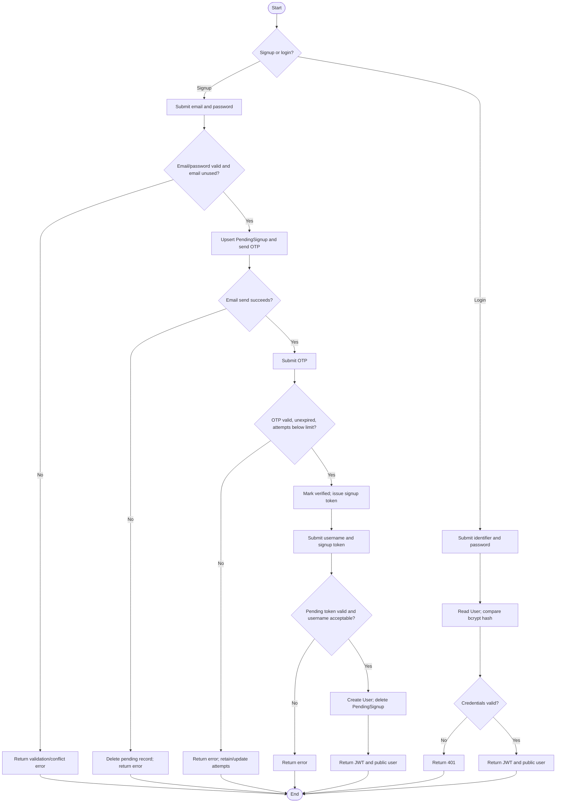

### 10.2 Starting and completing a solo game

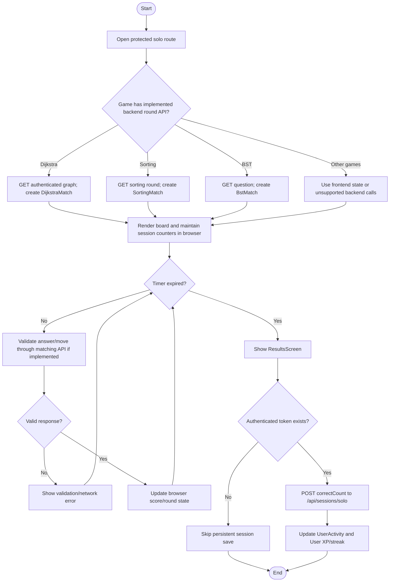

### 10.3 Validating an answer and updating score

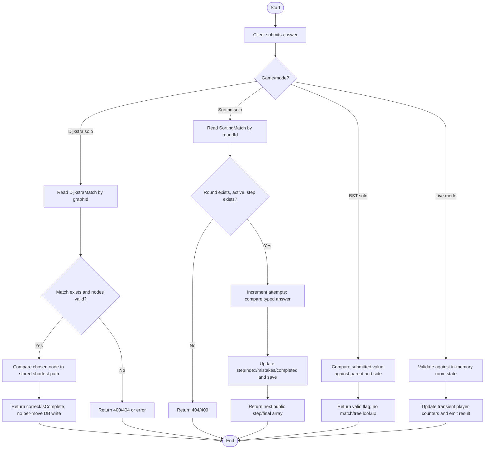

### 10.4 Saving a match result and updating progress

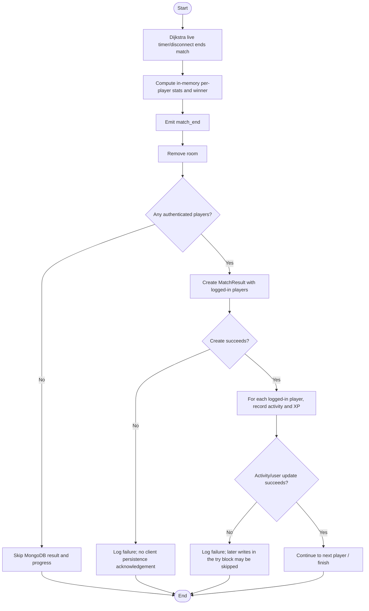

This flow is **not implemented** for BST or Sorting multiplayer; those handlers emit final stats and discard room state without database writes.

### 10.5 Creating and joining a multiplayer room

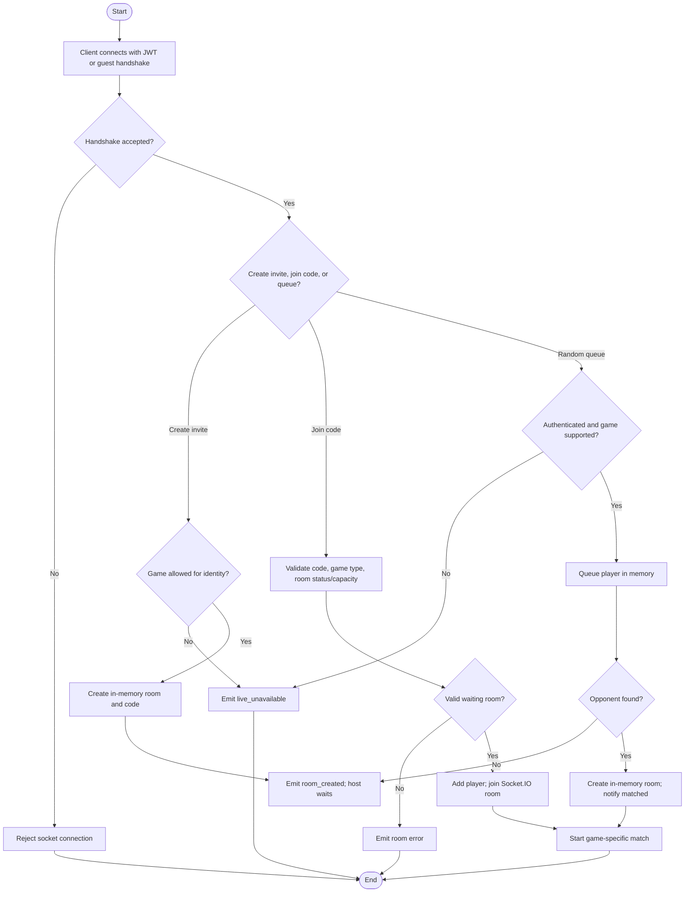

### 10.6 Playing and ending a multiplayer match

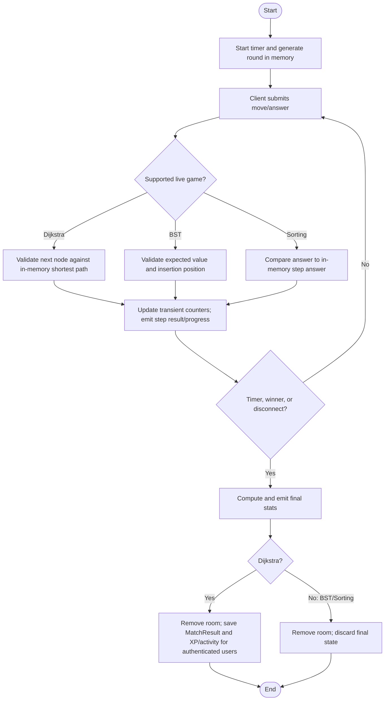

### 10.7 Leaderboard/history retrieval

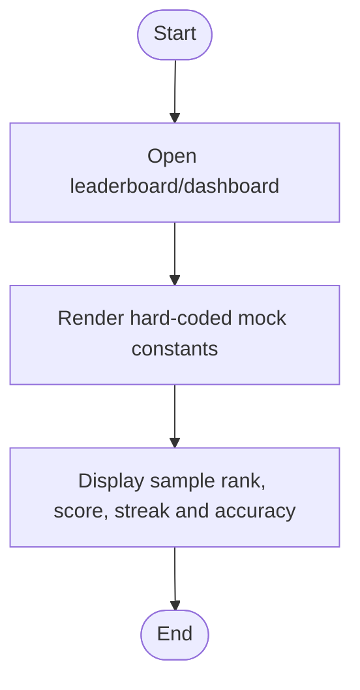

This describes the current frontend behavior. A backend leaderboard/history query workflow is **Not implemented**; no database read occurs.

## 11. Data-flow diagrams

### 11.1 Level 0 — context

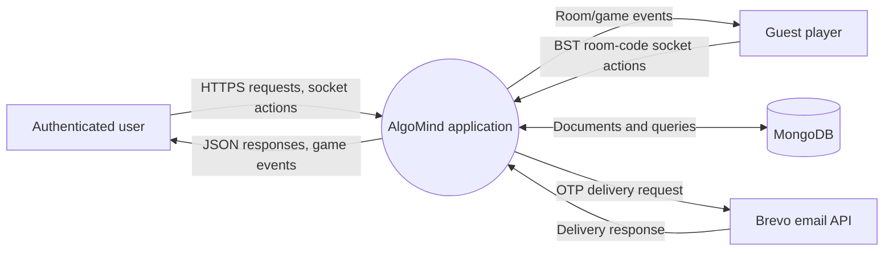

MongoDB and Brevo are external services to the application. MongoDB provider and deployment are **Unverified**; Brevo use is verified by the configured API URL and utility code.

### 11.2 Level 1 — system DFD

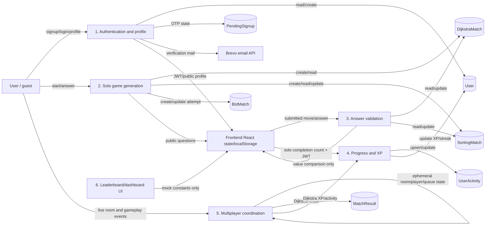

### 11.3 Level 2 — database-focused solo game lifecycle (Dijkstra)

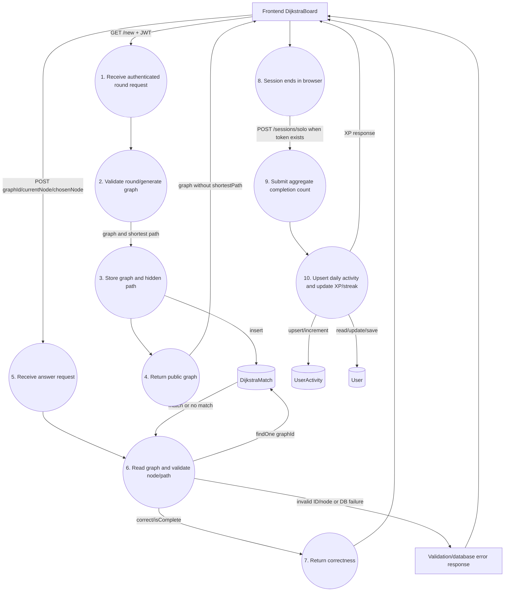

This is the actual split lifecycle: Dijkstra move validation does not update score or user progress; the later session endpoint trusts an aggregate client count. A generated Dijkstra document is TTL-expired, not tied to the user or completion record.

## 12. Database operations and CRUD matrices

### 12.1 Feature/workflow to collection matrix

| Feature/workflow | Model/collection | Read | Create | Update | Delete | Evidence |
|---|---|---:|---:|---:|---:|---|
| Signup start/verify/resend/complete | PendingSignup / `pendingsignups` | Yes | Upsert | Yes | Yes, explicit and TTL | `signupStart`, `signupVerify`, `signupResend`, `signupComplete` in [authController.ts](Backend/src/controllers/authController.ts) |
| Signup/login/profile | User / `users` | Yes | Signup completion | XP/streak only | No | [authController.ts](Backend/src/controllers/authController.ts), [activityTracker.ts](Backend/src/utils/activityTracker.ts) |
| Username availability | User / `users` | Yes | No | No | No | `usernameAvailable` |
| Solo completion/progress | UserActivity / `useractivities` | Selector lookup/upsert | Upsert | `$inc` | No | `recordActivityAndXP` |
| Solo completion/progress | User / `users` | By ID | No | Streak, date, XP | No | `recordActivityAndXP` |
| Dijkstra solo round/validation | DijkstraMatch / `dijkstramatches` | Validation lookup | Round creation | No | TTL | [dijkstraController.ts](Backend/src/controllers/dijkstraController.ts) |
| Sorting solo round/validation | SortingMatch / `sortingmatches` | Step lookup | Round creation | Attempt/step/mistake/completed via save | TTL | [sortingController.ts](Backend/src/controllers/sortingController.ts) |
| BST solo question/submit | BstMatch / `bstmatches` | No explicit read; update selector | Question creation | Score/completed if ID supplied | No | [bstController.ts](Backend/src/controllers/bstController.ts) |
| Dijkstra live result | MatchResult / `matchresults` | No | Result document | No | No | `endMatch` in [socketHandlers.ts](Backend/src/sockets/socketHandlers.ts) |
| BST/Sorting multiplayer | No collection for live result | No | No | No | No | Socket handlers keep state in memory and remove it after match |
| Leaderboard/history | No backend collection access found | No | No | No | No | Frontend uses constants; no REST route/controller |

### 12.2 CRUD by entity/module

| Entity | Create | Read | Update | Delete |
|---|---|---|---|---|
| User | Auth `signupComplete` | Auth login, `/me`, username check, socket username lookup | `recordActivityAndXP` | None |
| PendingSignup | Auth start/upsert | Auth signup methods | OTP attempt/verification/resend | Auth completion/mail failure; MongoDB TTL |
| UserActivity | `recordActivityAndXP` upsert | Selector used by upsert; no standalone read route | `$inc` in same upsert | None |
| BstMatch | BST `getQuestion` | No explicit query read | `submitScore` update, only when matchId supplied | None |
| DijkstraMatch | Dijkstra `createDijkstraMatch` | `validateDijkstraStep` | None | TTL |
| SortingMatch | Sorting `createSortingRound` | `validateSortingStep` | `validateSortingStep` document save | TTL |
| MatchResult | Dijkstra live `endMatch` | None found | None | None |
| Room/queue/live player | Socket room managers | Socket handlers | Socket handlers | Room cleanup/disconnect/timer; process exit |

No aggregate, bulk insert, user deletion, cascade behavior, or history/leaderboard query was found. Socket handlers are the only database writer for `MatchResult`; no model lacking a corresponding model file was discovered.

## 13. Current implementation gaps and inconsistencies

1. **No live database evidence.** This report infers schemas and collection names from Mongoose source. Production collections, indexes, migrations, and records remain unverified.
2. **Solo-session integrity is weakly coupled.** `/api/sessions/solo` trusts a client-provided count and has no game/session identifier or server-side proof of completion.
3. **BST solo score persistence is disconnected.** The board stores `matchId` but omits it from `submitScoreAPI`; the controller silently skips the update when `matchId` is absent. The validator does not use `matchId` or a stored tree. The optional `userId` field is never written.
4. **BST count has no upper bound.** Counts above the generator's 17 distinct values can leave question generation looping indefinitely.
5. **Leaderboard/dashboard are static.** Frontend sample user, XP, rank and leaderboard are not loaded from MongoDB; no endpoint exists.
6. **Game coverage is uneven.** Dijkstra, Sorting and BST solo routes exist. Dijkstra/BST/Sorting have live server handlers. Other registry games are not backed by corresponding backend routes; Floyd–Warshall has unmatched client calls/events.
7. **Live persistence is inconsistent.** Only Dijkstra live completion writes MatchResult and activity/XP; BST and Sorting live results disappear after room removal.
8. **Solo temporary records are not attached to users.** Dijkstra/Sorting docs carry no user reference; their TTL record is not history.
9. **Progress reads are missing.** Activity records and streak/XP are written, but daily activity, history and leaderboard retrieval are not implemented.
10. **Timing mismatch for BST live.** Server BST match timer is 120 seconds, while generic `GameSessionShell` defaults to 60 seconds; the UI may stop rendering gameplay before the server's BST timeout/result.
11. **Potential partial writes/concurrency.** Signup creation plus pending deletion and result creation plus per-user activity updates are not transactional. Activity updates have a unique compound index but no duplicate-key retry. Sorting round state is read/modified/saved non-atomically; duplicate submissions may race. No idempotency key exists for completion.
12. **Not all validation is server-authoritative.** BST solo client has an offline fallback that treats fetch failure as valid after client checks; generic solo session scoring is accepted without a replayable answer history.
13. **Current worktree state.** `Backend/src/controllers/bstController.ts` was already modified in the worktree when this analysis began. This report describes the current file contents; no application source, environment, or database was changed for this report.
14. **Guest policy differs by socket handler.** The generic multiplayer handler restricts guests to BST room-code matches, while the separate Sorting handlers do not apply that guest check. The frontend currently guards those pages, but the server does not consistently enforce the intended restriction.

## 14. Assumptions and unverified information

- Collection names are inferred from Mongoose’s default model-name pluralization. Custom collection options are not declared, but actual deployed names were not queried.
- Required/default/validation claims are schema-source claims. Database index build status and any legacy documents are unknown.
- No MongoDB connection or production environment was used. No credentials, secrets, tokens, or database contents are included.
- Vercel-style SPA rewrite is present, but deployment is not proven. A Render backend is not verified by repository configuration.
- No Redis or other durable cache/queue dependency or adapter was found.
- Existing repository tests include [Backend/src/sockets/stage1.test.ts](Backend/src/sockets/stage1.test.ts), covering socket authorization/room and BST behavior. No database integration test suite was identified.

## 15. SDS preparation recommendations

Before treating this implementation as a fully specified production design, decide whether solo gameplay scores must be server-verifiable and whether BST/Sorting live results should persist like Dijkstra results. If so, bind rounds to authenticated users or session records, return authoritative XP, and define idempotent completion handling. Bound BST question-count input. Implement or explicitly exclude leaderboard/history/profile APIs and unimplemented game backends. Define consistent timers, authorization requirements, relationship/cascade policy, and transaction/retry behavior. Finally, verify actual MongoDB collection/index state and deployed hosting/environment configuration through authorized operational evidence before describing them as confirmed.
